# Campus Food Insights — Project Report

## 1. Project Overview and Dataset Description
This project analyzes student food consumption, spending behavior, outlet preferences, and satisfaction levels on campus. The data was collected using a Google Form survey distributed among university students. 

The raw survey dataset contains **88 responses** across **20 original columns**. It captures student demographic information (year of study, gender, residential status, dietary preference), daily eating habits (meals per day, most frequently skipped meal, frequency of outside delivery), spending habits (monthly extra spend excluding mess fees, payment methods), outlet choices, decision factors, and overall satisfaction ratings on a 1–5 scale.

## 2. Data Cleaning Summary
Data cleaning was performed in `R/data_cleaning.R` using base R functions without external libraries:
- **Raw dimensions**: 88 rows and 20 columns.
- **Handling empty columns**: Six columns were completely empty (100% missing values, 88/88 NAs) in the raw CSV export: `Untitled Question`, the four dining facility rating columns (`Infrastructure and Seating`, `Staff Friendliness`, `Operating Hours/Availability`, `Waste Management/Cleanliness`), and the nutrition information question. These unpopulated columns and the `Timestamp` column were safely removed.
- **Renaming**: The remaining 13 survey questions were renamed to short, manageable identifiers: `year`, `residence`, `gender`, `diet`, `outlets`, `meals_per_day`, `skipped_meal`, `monthly_spend`, `outside_orders`, `factors`, `satisfaction`, `improvements`, and `payment`.
- **Standardization & text conversion**: Whitespace was trimmed across all character fields. Text values in `monthly_spend` (such as `"Rs. 2,000/-"` and `"around 1000"`) were converted into a clean numeric column `spend_mid` (range: 500 to 4000 INR). Ranges and text responses in `meals_per_day` (e.g., `"1-2 meals"` converted to `1.5`, `"1 times"` to `1.0`) and `outside_orders` (e.g., `"twice a week"` to `2.0`) were converted into numeric columns `meals_num` and `outside_num`. Outlet accent encoding was cleaned (e.g., "Nescafé" to "Nescafe").
- **Missing values and duplicates**: The core 13 questions had 0 missing entries across all 88 rows. Duplicate row checks revealed 0 duplicate responses. Satisfaction scores were verified to lie strictly within the valid 1–5 range.
- **Clean output**: Saved to `data/clean.csv` (88 rows, 16 columns, 0 missing values).

## 3. Basic Observations
Summary statistics and frequency distributions from `R/observation.R`:
- **Year of study**: 3rd Year students make up the vast majority with **75.0%** (66 students), followed by 1st Year with **13.6%** (12 students), and 2nd Year with **11.4%** (10 students).
- **Residence**: **95.5%** (84 students) live in campus hostels, while only **4.5%** (4 students) are day scholars.
- **Gender**: **63.6%** (56 students) identify as male and **36.4%** (32 students) as female.
- **Dietary preference**: Non-Vegetarians (**44.3%**, 39 students) and Vegetarians (**44.3%**, 39 students) form equal majorities, followed by Eggetarians (**10.2%**, 9 students) and Vegans (**1.1%**, 1 student).
- **Payment method**: **97.7%** (86 students) primarily pay via UPI/QR Code, while only **2.3%** (2 students) use cash.
- **Skipped meals**: A striking **70.5%** (62 students) skip breakfast most often, followed by lunch at **13.6%** (12 students), evening snacks at **9.1%** (8 students), rarely skip at **5.7%** (5 students), and dinner at **1.1%** (1 student).
- **Monthly spend**: The median extra monthly food spend is **Rs. 1,500** (mean: **Rs. 1,753**; 1st quartile: Rs. 1,150; 3rd quartile: Rs. 2,000; range: Rs. 500 to Rs. 4,000).
- **Overall satisfaction**: The mean campus food satisfaction score is **3.01 / 5.0** (median: 3.0). Only **27.3%** (24 out of 88 students) rated satisfaction at 4 or 5, while 42 students gave a neutral rating of 3, and 22 students were dissatisfied (ratings 1 or 2).

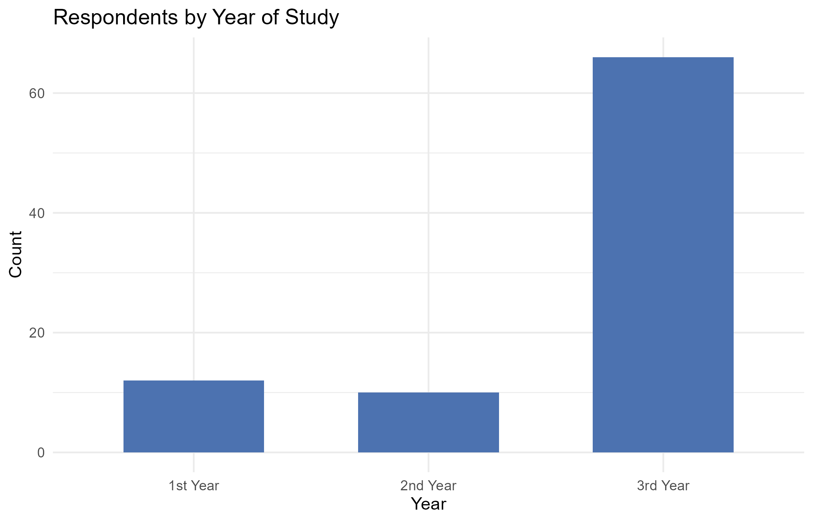
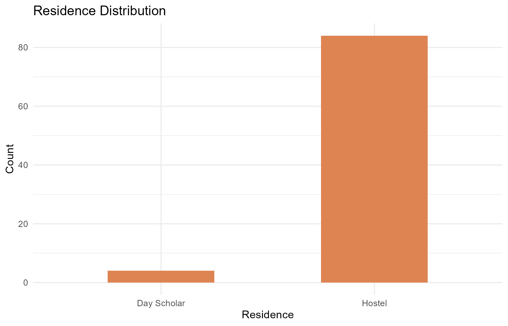
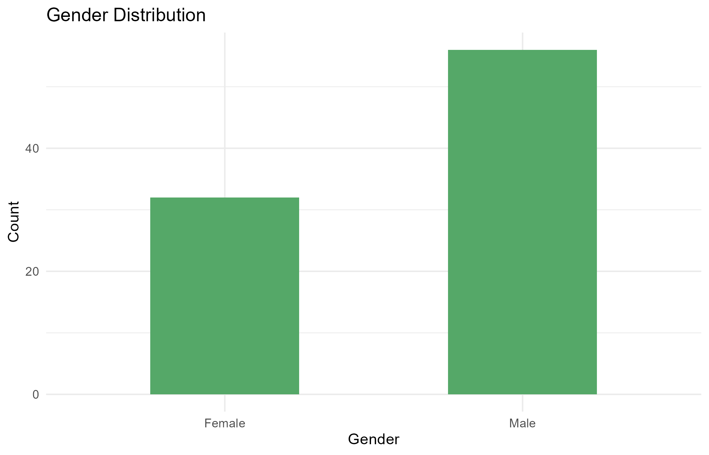
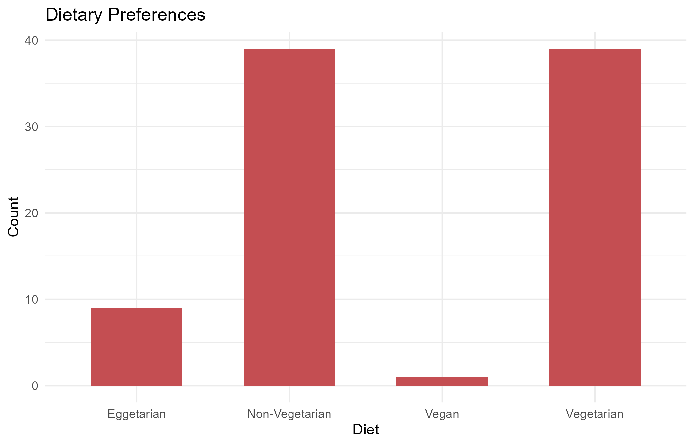
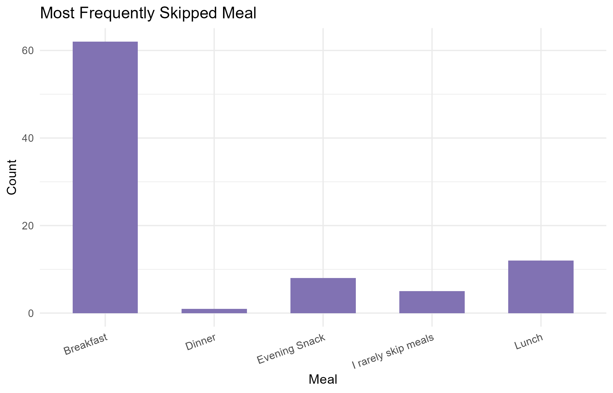
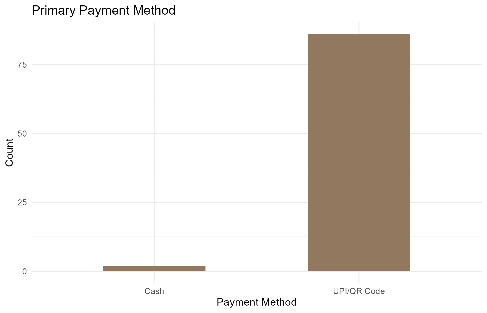
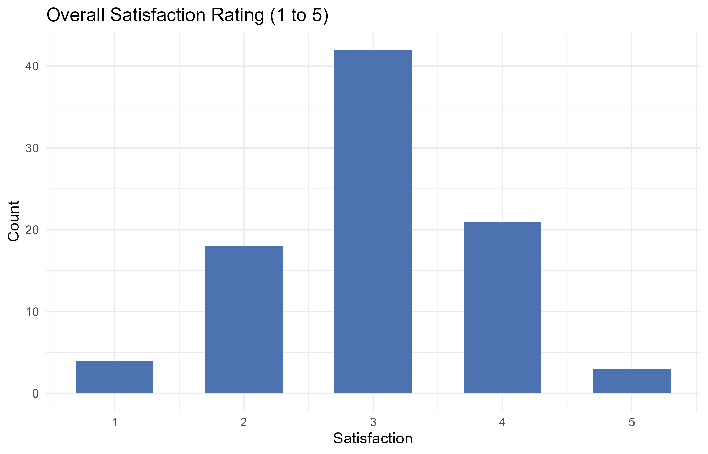
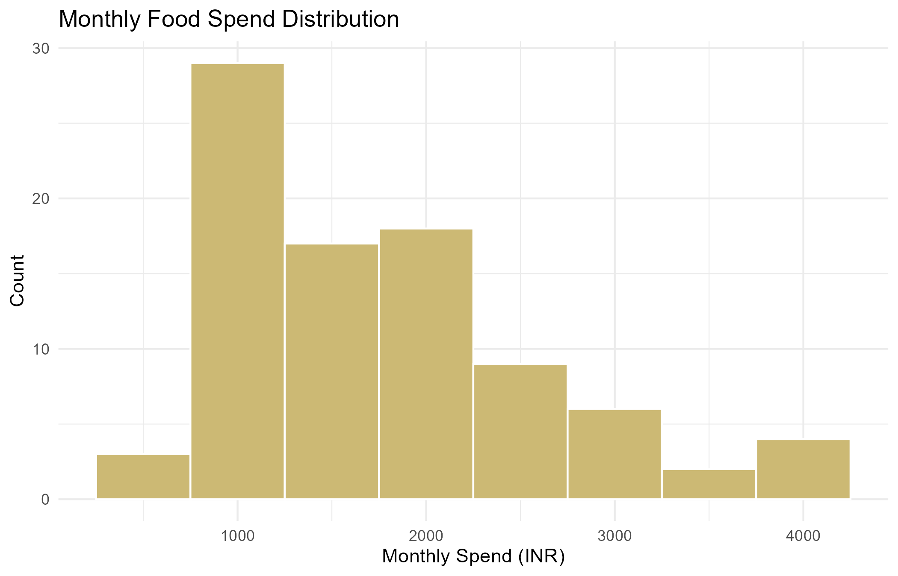

## 4. Exploratory Data Analysis (EDA) Findings
From `R/eda.R`:
- **Satisfaction by subgroup**:
  - By Year: 2nd Year students reported the highest average satisfaction (**3.30**, n=10), followed by 1st Year (**3.08**, n=12), while 3rd Year students reported the lowest (**2.95**, n=66).
  - By Gender: Females and males have nearly identical average satisfaction (**3.00** vs **3.02**).
  - By Residence: Day scholars and hostellers average **3.00** and **3.01** respectively.
  - By Diet: Eggetarians averaged **3.11** (n=9), Non-Vegetarians **3.03** (n=39), Vegans **3.00** (n=1), and Vegetarians **2.97** (n=39).
- **Monthly spend by group**:
  - Hostellers spend significantly more on extra food (**Rs. 1,777 to 1,830** average across cohorts) compared to Day Scholars (**Rs. 1,150** average).
- **Outlet satisfaction comparison**:
  - Nescafe users report the highest overall campus satisfaction (**3.13**, n=38), followed by Yadav Canteen (**3.04**, n=26), Hostel Mess (**3.00**, n=46), Night Canteen (**3.00**, n=21), and Snacker (**2.89**, n=35).
- **Correlation analysis**:
  - Correlation between monthly spend and satisfaction is weak positive: `r = 0.102` (p = 0.342).
  - Outside delivery orders have a slight positive correlation with satisfaction (`r = 0.112`).
  - Campus meals per day correlates slightly positively with satisfaction (`r = 0.117`) and negatively with monthly spend (`r = -0.129`).
- **Statistical hypothesis tests**:
  - Chi-square test on residence vs skipped meal: `p = 0.0757` (no statistically significant difference; breakfast skipping is prevalent across both hostels and day scholars).
  - Chi-square test on gender vs satisfaction (satisfied vs not): `p = 1.000` (gender plays no significant role in satisfaction).
  - Linear correlation test between monthly spend and satisfaction: `r = 0.102, p = 0.3422` (weak linear relationship across the overall continuum).

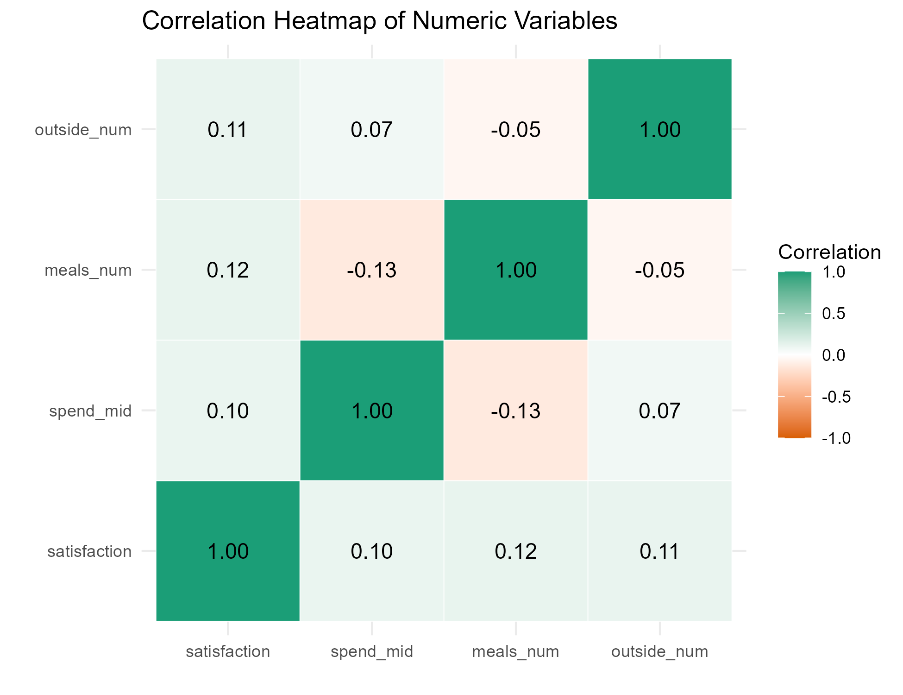
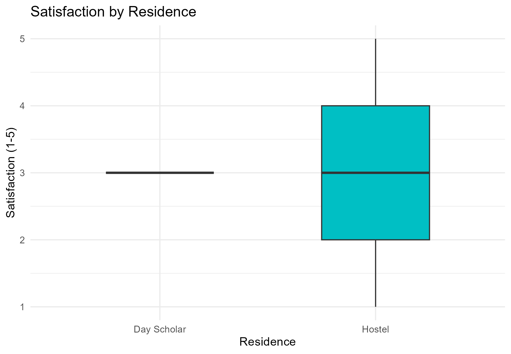
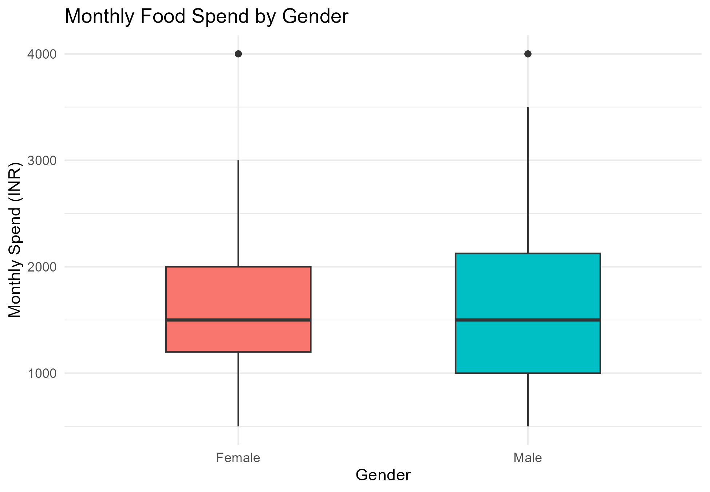
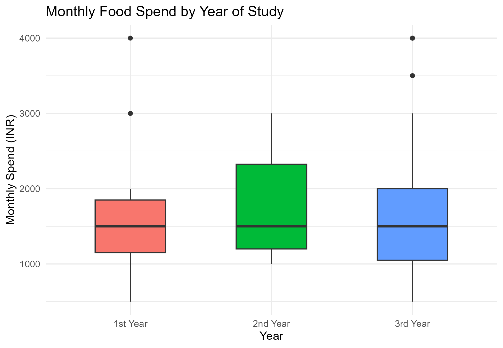
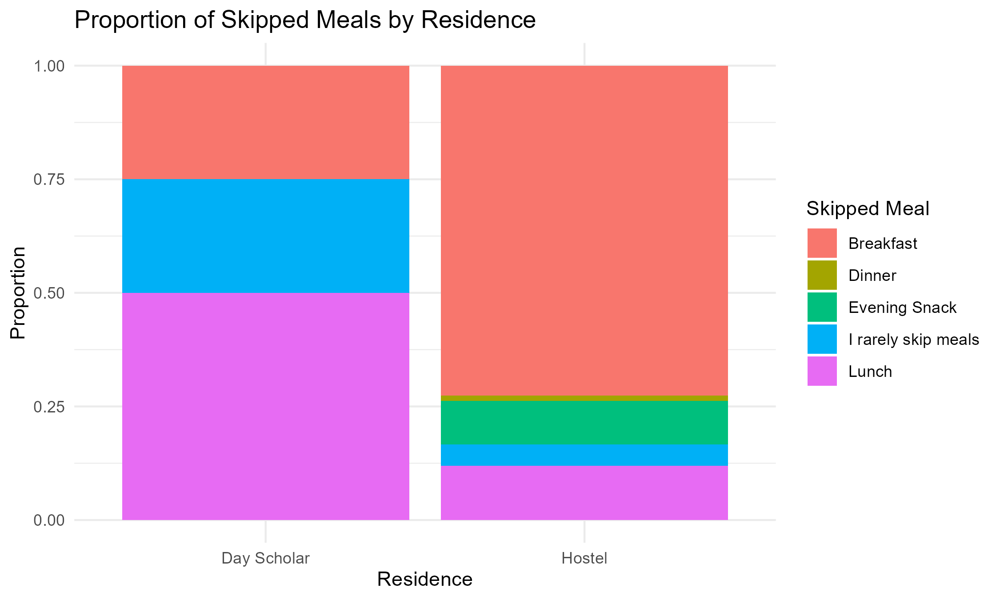
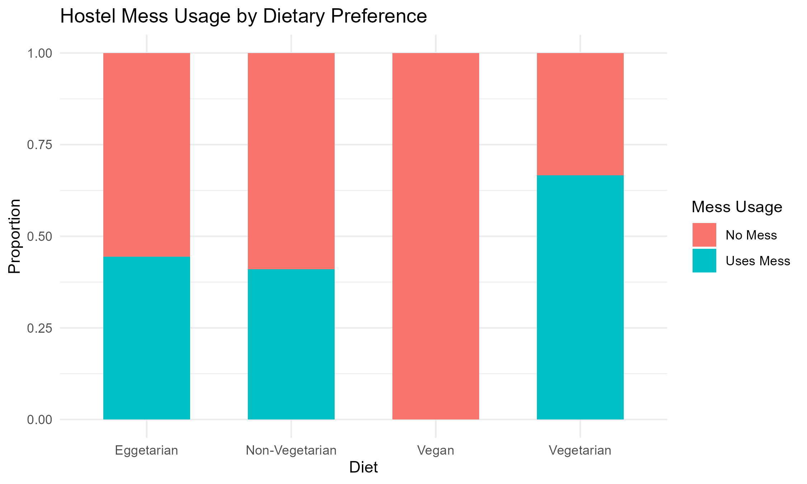
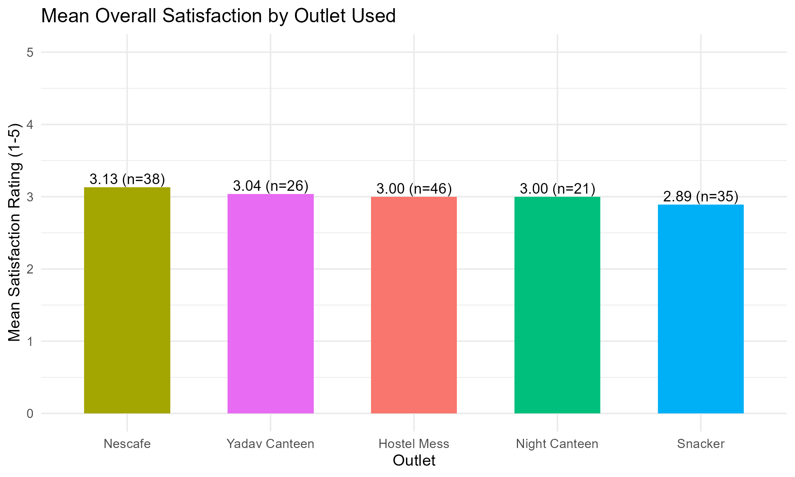

## 5. Data Mining Findings

### Association Rules (Apriori Algorithm)
Running the Apriori algorithm (`support >= 0.12`, `confidence >= 0.60`, `minlen = 2`) on all food habits, decision factors, and desired improvements identified **322 rules**. The top rules sorted by lift highlight clear student behavior patterns:
1. **Rule 1**: `{factor=Food Quality, factor=Portion Size, skip=Breakfast} => {improve=Lower Prices}`
   - *Support*: 12.5%, *Confidence*: 84.6%, *Lift*: **2.01** (count: 11).
   - *Meaning*: Students who prioritize both food quality and portion size while skipping breakfast almost always demand lower prices.
2. **Rule 2**: `{improve=Better Food Quality, outlet=Hostel Mess, skip=Breakfast} => {diet=Vegetarian}`
   - *Support*: 14.8%, *Confidence*: 86.7%, *Lift*: **1.96** (count: 13).
   - *Meaning*: Hostel mess users who skip breakfast and want better food quality are overwhelmingly Vegetarian students.
3. **Rule 3**: `{factor=Taste, improve=Better Hygiene/Cleanliness, skip=Breakfast} => {diet=Non-Vegetarian}`
   - *Support*: 12.5%, *Confidence*: 84.6%, *Lift*: **1.91** (count: 11).
   - *Meaning*: Non-Vegetarian breakfast skippers who prioritize taste are strongly associated with demanding better hygiene and cleanliness.
4. **Rule 4**: `{improve=Better Food Quality, improve=Lower Prices} => {outlet=Nescafe}`
   - *Support*: 14.8%, *Confidence*: 72.2%, *Lift*: **1.67** (count: 13).
   - *Meaning*: Students who want both better quality and lower prices frequently use Nescafe, showing that even popular outlets face price-to-quality scrutiny.
5. **Rule 5**: `{improve=Better Taste, outlet=Hostel Mess} => {factor=Hygiene/Cleanliness}`
   - *Support*: 13.6%, *Confidence*: 85.7%, *Lift*: **1.80** (count: 12).
   - *Meaning*: Hostel mess users demanding better taste also view hygiene and cleanliness as critical decision factors.

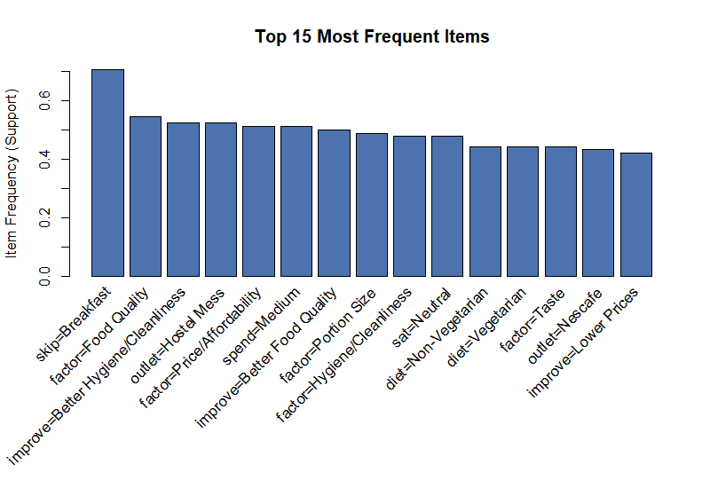

### K-Means Clustering
Using the elbow method on scaled features (`spend_mid`, `satisfaction`, `outside_num`, `meals_num`), the total within-cluster sum of squares shows a clear inflection at **k = 3**:
- **Cluster 1 — Dissatisfied Infrequent Campus Diners (n = 26)**:
  - Average monthly spend: **Rs. 1,727**
  - Average satisfaction: **2.08 / 5.0** (lowest)
  - Outside orders per week: **0.92**
  - Campus meals per day: **0.38** (lowest campus meal engagement)
  - *Description*: Students who rarely eat at campus outlets and express significant dissatisfaction with available food options.
- **Cluster 2 — Budget Regular Campus Diners (n = 47)**:
  - Average monthly spend: **Rs. 1,445** (lowest budget)
  - Average satisfaction: **3.19 / 5.0** (moderate)
  - Outside orders per week: **0.77** (lowest outside delivery reliance)
  - Campus meals per day: **1.38** (highest campus meal frequency)
  - *Description*: Core campus eaters who rely heavily on campus outlets and the hostel mess daily, maintaining a tight budget.
- **Cluster 3 — High Spenders & Highly Satisfied (n = 15)**:
  - Average monthly spend: **Rs. 2,767** (highest budget)
  - Average satisfaction: **4.07 / 5.0** (highest satisfaction)
  - Outside orders per week: **1.47** (highest outside ordering)
  - Campus meals per day: **0.57**
  - *Description*: Students with greater spending power who supplement campus food with premium outlets and outside orders, leading to notably higher overall food satisfaction.

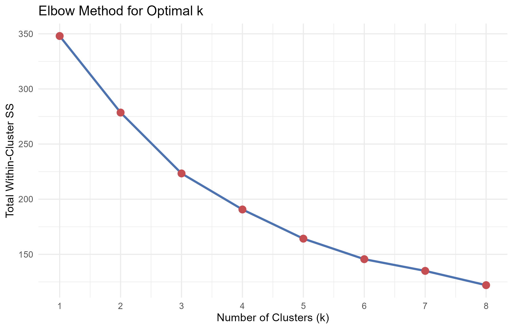
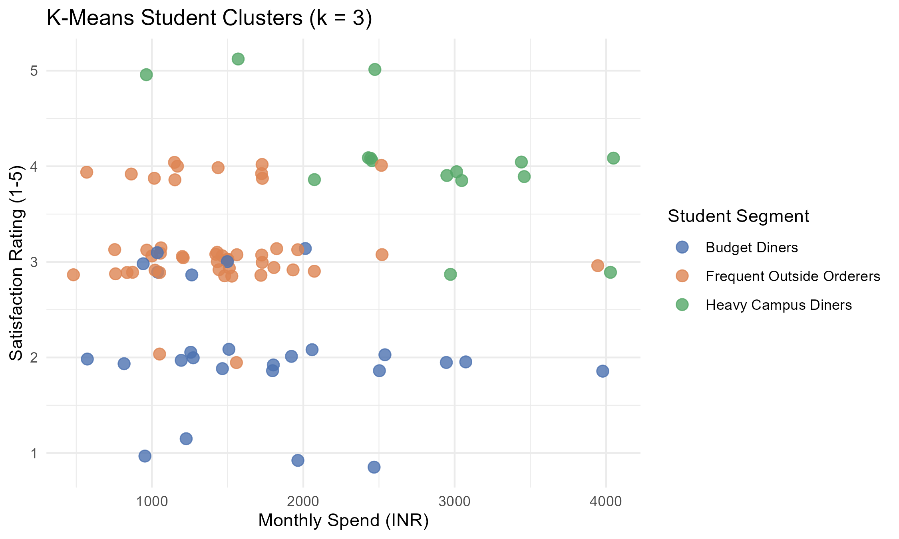

### Logistic Regression Model
Predicting satisfaction (satisfied = rating >= 4):
- Logistic regression on `spend_mid`, `outside_num`, and `meals_num` achieved an overall classification accuracy of **76.1%**.
- Monthly spend (`spend_mid`) is a positive and statistically significant predictor (`p = 0.0414 *`, coefficient: +0.00058), confirming that higher financial flexibility significantly increases the probability of student dining satisfaction.

## 6. Key Takeaways and Recommendations for Campus Food Outlets
1. **Address the Breakfast Crisis**: Over **70.5%** of students skip breakfast, primarily due to rigid morning hours and limited grab-and-go options. Outlets should introduce quick, affordable breakfast items (poha, sandwiches, egg/paneer rolls) between 8:00 AM and 10:30 AM near academic blocks and hostels.
2. **Improve Hostel Mess Quality and Hygiene for Vegetarians**: Association rules show that mess dissatisfaction is concentrated among Vegetarian students who demand better taste, hygiene, and nutritious options. Conducting routine hygiene audits and introducing recipe variety can improve baseline satisfaction.
3. **Value-for-Money Combos at Commercial Outlets**: Nescafe and Snacker users frequently demand lower prices and better quality combos. Introducing student meal combos priced between Rs. 60–100 will better serve the large cluster of budget diners (Cluster 2, n=47).
4. **Digital Payments Dominance**: With **97.7%** using UPI/QR Code, ensuring seamless network connectivity and high-speed QR billing at all counters is critical to reduce wait times.

## 7. Limitations
- **Sample Size**: The survey has 88 respondents, predominantly 3rd Year students (75%) and hostellers (95.5%), meaning day scholars and junior batches are underrepresented.
- **Self-Reported Data**: Monthly spend and meal frequencies are estimates self-reported by respondents rather than verified billing transactions.
- **Missing Specific Facility Ratings**: In the original Google Form export, five questions (dining infrastructure, staff friendliness, operating hours, cleanliness ratings, and nutrition labeling) were completely blank (100% missing values) and could not be evaluated independently.

